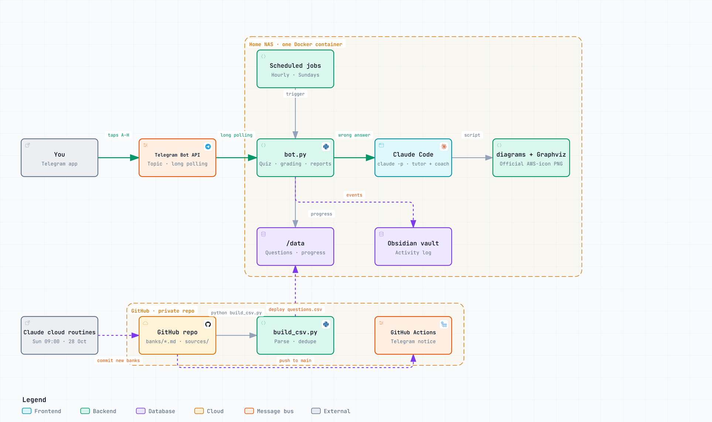

# AWS Certified Solutions Architect — Professional Portable

A self-hosted Telegram study bot for the **AWS Certified Solutions Architect – Professional** exam (SAP-C02 until 16 Nov 2026, **SAP-C03** from 17 Nov 2026). It drills you with practice questions, draws an **AWS architecture diagram with official AWS icons** when you get one wrong, tracks your progress, and tells you every Sunday whether you are ready to sit the exam.

"Portable" because the whole thing is one container: drop it on any machine with Docker (a home NAS, a VPS, a laptop), give it a Telegram bot token and a Claude Code login, and study from your phone.

> Unofficial and independent. Not affiliated with or endorsed by Amazon Web Services. The question banks are practice sets written for study, not real exam items. Never use exam dumps: they break the AWS certification agreement.



*Interactive version with pan, zoom, search and relationship tracing: open [`docs/architecture.html`](docs/architecture.html) in a browser.*

## What you get

| | |
|---|---|
| **One tap to answer** | One full-width button per option (A–H). "Select TWO/THREE" questions tick, then ✅ Submit. |
| **Right** | Verdict + the bank's explanation + a 🎓 *Explain more* button (Claude is only called if you tap it). |
| **Wrong** | Verdict + explanation, then an **AWS architecture diagram** drawn by Claude and rendered with [`diagrams`](https://diagrams.mingrammer.com) + Graphviz using **official AWS icons**. 🎓 *Explain more* reveals the tutor text, already generated, so it costs nothing. |
| **Hourly drill** | A question every `QUIZ_EVERY_MIN` minutes inside `QUIZ_HOURS` (default 09:00–22:59), only after you answered the previous one. `/quiz` works any time. |
| **Sunday 22:00 · report** | This week's right/wrong, first-try accuracy per bank, a predicted score on the 1000 scale (pass mark 750), a readiness verdict, and a short Claude coach note naming what to drill next. `/report` on demand. |
| **Growing bank** | Questions live in `banks/*.md` (format in [`AGENT.md`](AGENT.md)). A scheduled Claude cloud agent can hunt for new, legitimate practice questions every week and commit them; a GitHub Actions workflow posts a notice to your Telegram topic. `/refresh` reloads the bank after a deploy. |

Commands: `/quiz` `/explain` `/report` `/stats` `/refresh` `/reset` `/whoami`

## What ships in this repo

- **80 original SAP-C03 scenario questions** in `banks/`, written for the new skill areas AWS announced for SAP-C03 (Bedrock agents and guardrails, AgentCore, resilience engineering, VPC Lattice, DevSecOps, Iceberg lakehouse and Clean Rooms, post-quantum KMS). Unofficial; verify details against the AWS docs.
- The bot, the bank builder, the Docker files and the architecture diagram.

Third-party practice questions (AWS's official sample questions, community sites, other GitHub banks) are **not** redistributed here. `build_csv.py` knows how to parse several of them from files you download yourself into `sources/` (see the parser sections for the expected file names); anything missing is skipped. Your compiled `data/questions.csv` stays on your disk.

## Files

| File | Purpose |
|---|---|
| `bot.py` | The bot (python-telegram-bot 22, long polling): questions, grading, tutor, diagrams, weekly report. |
| `build_csv.py` | Builds `SAP-C03_practice_questions_2026.csv` (full) and `data/questions.csv` (bot schema) from `banks/*.md` plus any downloaded `sources/`. `python -I build_csv.py` |
| `banks/*.md` | Authored question banks, one file per source. Format and rules in `AGENT.md`. |
| `AGENT.md` | Instructions for the weekly cloud agent: what counts as a legitimate source, the file format, build and commit steps. |
| `test_bot.py` | `python test_bot.py`: parsing, buttons, picker, diagram guard, schedule window, report metrics. |
| `send_test_question.py` | Posts one question into `BOT_CHAT` through the Bot API (the running bot handles the buttons). |
| `Dockerfile`, `compose.yaml` | One container: Python + Claude Code + Graphviz. |
| `run.ps1` | Local run on Windows using the PC's logged-in `claude`. |
| `bot.env.example` | All settings. Copy to `bot.env`; never commit it. |
| `.github/workflows/notify-telegram.yml` | Posts bank updates to a Telegram topic (secrets `TELEGRAM_BOT_TOKEN`, `TELEGRAM_CHAT_ID`, `TELEGRAM_TOPIC_ID`). |
| `docs/architecture.*` | Archify diagram spec, interactive HTML and PNG. |

## Setup

1. `@BotFather` → `/newbot` → token into `bot.env` (`TELEGRAM_BOT_TOKEN`). Send `/whoami` to the bot and put your ID in `ALLOWED_USER_IDS`.
2. `python -I build_csv.py` → `data/questions.csv` (80 rows from the shipped banks; more if you add `sources/`).
3. Group topic (optional): add the bot to the group and set `BOT_CHAT=<chat_id>/<topic_id>`.
4. Docker host: `claude setup-token` on your PC → `CLAUDE_CODE_OAUTH_TOKEN` in `bot.env`, copy the folder, then
   ```sh
   docker compose up -d --build
   ```
   (The first build downloads Claude Code, Graphviz and the Python packages; on a slow link it takes a while.)
5. Local instead: `.\run.ps1`. Only one poller per bot token: stop the local copy before the container runs.

## Cost

One `claude -p` call per wrong answer and one per weekly report. With Sonnet, roughly US$0.10–0.50 per wrong answer. Set `CLAUDE_MODEL=haiku` to cut it.

## Adding a bank

Create `banks/<date>-<source>.md` in the format shown in `AGENT.md` (header lines, numbered questions with A–E options, an answers table with a one-line explanation each), run `python -I build_csv.py`, restart the bot or send `/refresh`.

## License

MIT for the code. The shipped SAP-C03 questions are original work and carry the same license; they are practice material, not exam content.
